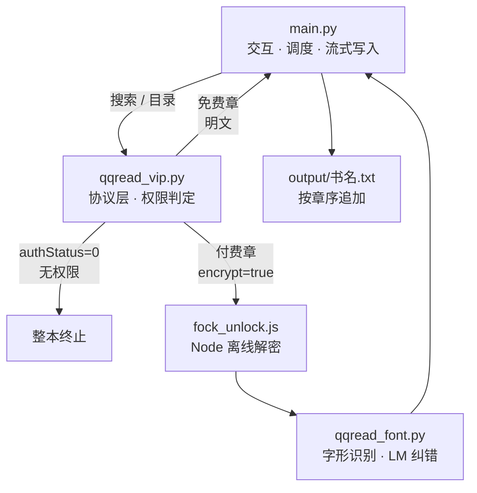

# qqread-dl

**纯协议实现的 QQ 阅读内容采集器** · 不启浏览器，两层反爬全离线还原

不依赖 Selenium / Playwright，不加载 `.wasm`，不使用任何第三方 HTTP 库——
4 个接口全部手写协议栈，服务端的两层反爬（Fock 加密 + 伪字体）全部在本地离线还原。


| 实测指标 | 数值 |
|---|---|
| 手写代码量 | 约 2500 行（Python 2243 / JS 273，不含第三方内核） |
| 单章耗时 | 免费章 ~0.2 s；付费章解密 + 还原 1–3 s |
| 字形还原准确率 | **97.6%–98.2%**（以 203 字官方试读明文为基准回归） |
| 字形索引构建 | 6763 字，矩阵化改写后提速 **约 18 倍** |
| 运行期磁盘残留 | **0**（中间文件自清理；早期版本曾累积 2 GB+） |
| 仓库内凭据 | **0**（凭据与项目目录物理隔离） |

> ⚠️ **本项目只采集当前账号本身有权访问的内容。** 判定无权限即整本终止，
> 不实现、也不提供任何绕过付费或试读截断的手段。详见[第六节](#六权限边界)。

---

## 一、它解决的是什么问题

QQ 阅读的网页端有两个不寻常的设计，让常规爬虫方案全部失效：

**① 付费章节的内容不是 HTML，而是密文。**
接口返回的是 base64 密文，必须用 SSR 页面里的 `fkConfig` 配置、
账号 `fuid` 和**章节号**一起，喂进站方的 Fock 加密内核才能解出。

**② 解出来的也不一定是字。**
密文解开后是一段 HTML，但里面的字符是伪造码位——真实的字被渲染成图片字形，
由服务端每章重新生成的 TTF 字体决定。直接读取文本节点，得到的是乱码。

所以这个项目要解决的不是"发请求"，而是**在完全没有浏览器的条件下，
把这两层还原逻辑搬到本地**：

- Fock 内核是 Emscripten 的 **wasm2js 产物**（全程不出现 `WebAssembly`、不加载 `.wasm`），
  这意味着它可以直接在 Node 里离线运行——不需要补浏览器环境。
- 伪字体是**逐章重新生成**的，映射关系不能跨章缓存，只能靠字形比对逐字识别。

结果是：单章 0.2 s，无浏览器渲染开销，不占一个 Chrome 进程。

---

## 二、30 秒跑起来

```bat
安装依赖.bat      :: 只需一次，装 numpy / Pillow 并检测 Node
一键运行.bat      :: 主入口
```

按提示输入关键词 → 选择序号 → 等待完成。产物在 `output/`：
`搜索结果.json` 和 `<书名>.txt`。

未配置账号时自动进入**匿名模式**，只下免费章，同样能跑通全流程。
未输入搜索关键词时程序会直接退出，不会发起空搜索。

命令行方式：

```bat
python main.py
```

非交互环境（管道、重定向）没有输入关键词时会明确报错退出，不会使用默认搜索词。

---

## 三、工作流程



调度层拿到章节列表后，5 线程并发取章，**按章序流式追加写入**目标文件
（边下边写，中断不丢已下内容）。付费章在进入写入队列前，必须依次通过
解密与字形还原两道工序；任一道判定失败，整本立即停止。

---

## 四、关键技术决策

每一条都是"为什么不用更常见的做法"的答案——也是这个项目最容易踩坑的地方。

| 难点 | 常见做法 | 本项目做法 | 选择理由 | 代价 |
|---|---|---|---|---|
| **HTTP 请求** | requests / httpx | 标准库 `urllib` 手写会话 | 零第三方 HTTP 依赖，任何 Python 环境直接可跑 | 需自己处理 Cookie、超时、重试、编码 |
| **Fock 解密** | 起 Puppeteer 补浏览器环境跑原站 JS | 确认是 wasm2js 产物后，抽出内核在 Node 离线跑 | 不启浏览器，内存与启动开销极低，也不依赖 DOM | 必须随仓库分发 191 KB 的 glue（不可重建） |
| **字形匹配** | 逐像素比对 / 通用 OCR 模型 | 双向 Chamfer 距离（3-4 距离变换） | 服务端已给出 TTF，可直接渲染出**精确字形**做掩码比对，比 OCR 识别截图更准更快；且伪码位与真字无稳定对应，通用 OCR 覆盖不足 | 需预建 6763 字索引（首次数分钟 / ~200 MB） |
| **纠错** | 纯几何阈值 或 纯语言模型 | 几何 top-8 + bigram Viterbi，**几何门控**（`margin > 1.2` 时压过 LM） | Chamfer 尺度 0–5、`-logP` 尺度 0–16，直接混加会让 LM 主导，把正确的「即」改成「那」 | 门控阈值需按参照字体实测调参 |
| **语言模型语料** | 拿已解码的 txt 回灌训练 | 只用**其它书 + 本书免费章明文** | 解码结果自带错字，回灌会自我强化（实测错字从 1 处涨到 9 处） | 新书首次运行需额外拉语料，启动稍慢 |
| **写入策略** | 全书下完内存拼接再落盘 | 按章序流式追加，`Lock` 保护共享游标 | 内存占用恒定，中断不丢已下内容 | 乱序完成需等待前序章节，失败章节需重试补偿 |
| **凭据存放** | 项目内 `config.json` | 项目目录**之外**的 7 级优先级查找 | git 历史不可逆，一旦提交即使 `git rm` 也能被翻出来 | 多一层查找逻辑，用户需知道去哪填 |

关于 Fock 的两个实测细节（都踩过）：

- `unlock()` 第二个参数必须是**章节号字符串**（如 `"22"`），不是响应里的 `ccid`——传错会静默解出空串。
- `fkp` 密钥全局固定，取一次缓存到凭据目录即可，不必每章重取。

---

## 五、性能与准确率

| 场景 | 实测结果 |
|---|---|
| 搜索 | 3 键 × 10 条，写入 `output/搜索结果.json` |
| 免费章（匿名，无会员） | 前 21 章，顺序完整、无乱码 |
| 会员有效期内 | 免费章 + 付费章（Fock + 字体还原）连续下载 |
| 单章耗时 | 免费章 ~0.2 s；付费章 1–3 s |
| 字形还原准确率 | 97.6%–98.2%（203 字官方试读明文为基准） |
| 字形索引构建 | 6763 字，矩阵化后提速约 18 倍 |

残余错字基本都是**形近字**（几/儿、犬/大、绐/给）——单字骨架层面几乎完全一致，
几何方法无法区分，只能靠语料兜底。这是当前方案的固有上限，不是 bug。

---

## 六、权限边界

本项目**只下载当前账号本身有权阅读的章节**，判定逻辑写死在协议层：

| 服务端返回 | 判定 | 行为 |
|---|---|---|
| `authStatus=1` + `encrypt=true` | 有权限 | 正常解密下载 |
| `authStatus=0` | 无权限，固定截断 203 字试读 | **立即停止整本** |
| `data` 为空 / 关键字段缺失 | 无法确认权限 | **立即停止整本** |

第三条是为了防止把 203 字试读当作正文写进文件——宁可停下，也不产出残缺内容。

不实现、也不提供任何绕过付费墙或试读截断的手段。

---

## 七、项目结构

| 文件 | 职责 |
|---|---|
| `main.py` | 调度层：依赖自举、交互搜索、并发下载、流式写入 |
| `qqread_vip.py` | 协议层：会话 Cookie、HTTP 请求、fkp 密钥、调 Node 解密、**权限判定** |
| `qqread_font.py` | 字体层：TTF 解析、CSS 规则、字形识别、语言模型纠错 |
| `qqread_config.py` | 配置层：凭据隔离加载、脱敏日志、缓存目录 |
| `fock_unlock.js` | Fock 解密器（Node CLI） |
| `lib/fock_glue.js` | Fock 内核（wasm2js 产物，**不可重建，必须随仓库分发**） |
| `*.bat` | Windows 一键脚本，见[第八节](#八环境与故障排查) |

分层原则：**协议层不知道字体，字体层不知道网络，配置层不打印任何密钥值。**
三层都可以单独 import 自检，互不牵连。

---

## 八、环境与故障排查

### 8.1 依赖

| 项 | 要求 | 说明 |
|---|---|---|
| Python | 3.8+（实测 3.13） | `main.py` 启动时自检 numpy / Pillow，缺失则自动切换解释器 |
| numpy / Pillow | 必需 | 字体层依赖，`安装依赖.bat` 或 `pip install numpy pillow` |
| Node.js | 仅付费章需要 | 按 `NODE_EXE` → PATH → 默认安装路径 → nvm 目录顺序查找 |
| 参照字体 | 微软雅黑（默认） | 自动探测 msyh → PingFang → Noto CJK / 文泉驿，全找不到会在启动时明确报错 |

显式指定（任一项探测不到时）：

```bat
set QQREAD_PY=D:\some\python.exe
set NODE_EXE=D:\some\node.exe
set QQREAD_REF_FONT=C:\Windows\Fonts\msyh.ttc
```

> 换参照字体后字形识别准确率会变化，需重做基准回归。

### 8.2 各层自检

```bat
python qqread_config.py    :: 凭据加载状态与来源（不打印任何密钥值）
python qqread_font.py      :: 参照字体 / 字形索引 / 解码器初始化
python qqread_vip.py       :: 接口连通性、账号信息、Node 与胶水就绪情况
```

`环境自检.bat` 会依次跑完这三项。

### 8.3 凭据在哪

凭据**不放在项目目录**，按优先级先命中先用：

| 顺序 | 位置 | 场景 |
|---|---|---|
| 1 | 环境变量 `QQREAD_COOKIE` | CI / 临时使用，**完全不落盘** |
| 2 | 环境变量 `QQREAD_CREDENTIALS` | 自定义 JSON 路径 |
| 3 | 环境变量 `QQREAD_HOME` | 自定义目录 |
| 4 | `%USERPROFILE%\.qqread\credentials.json` | **日常推荐**，设备级隔离 |
| 5 | `%APPDATA%\qqread\credentials.json` | 备选 |
| 6 | 项目上级目录的 `.qqread\credentials.json`（最多向上 4 层） | 便携 / 本地开发 |
| 7 | 项目目录 `session_cookies.json` | 兼容旧版，已被 `.gitignore` 屏蔽 |

判定标准是**能解析出非空 Cookie**，不是"文件存在"——所以空模板不会被误报为已配置，
也不会遮蔽后面真正填好的凭据（`环境自检.bat` 会标成 `△空模板`）。

凭据文件支持三种格式，自动识别：

```json
{"cookie": "uid=...; fuid=...; usid=..."}
{"cookies": [{"name": "uid", "value": "..."}]}
{"uid": "...", "fuid": "...", "usid": "..."}
```

获取方式：浏览器登录 <https://book.qq.com> → `F12` → Application → Cookies → 全选复制，
或用 `配置账号.bat` 生成模板后填入。

### 8.4 常见问题

| 现象 | 处理 |
|---|---|
| `未找到参照字体` | 装微软雅黑，或设 `QQREAD_REF_FONT` 指向任意中文 TTF/TTC |
| `缺少依赖 numpy / Pillow` | `pip install numpy pillow`，或设 `QQREAD_PY` |
| `未找到 node 可执行文件` | 装 Node.js，或设 `NODE_EXE` |
| 只下了前 N 章就停 | 匿名模式 / 会员过期 / 该书付费章无权限——均为设计行为 |
| `Cookie 已失效` | 重新登录导出，更新凭据文件 |
| `code=-4 登陆鉴权失败` | 登录态已过期；重新登录导出 Cookie。详情查询会自动回退匿名，VIP 章仍需有效登录 |
| 首次运行卡几分钟无输出 | 正在重建字形索引，正常 |
| 零星形近字错字 | 方案固有局限，见[第五节](#五性能与准确率) |

### 8.5 磁盘不会被撑爆

两处中间文件都做了自清理（早期版本会累积到 2 GB 以上）：
`fock_unlock.js` 打补丁后的 glue（约 191 KB/次）退出前删除；
每章伪字体写入 `cache/tmp_fonts/<pid>/`，读入内存后立即删除，`atexit` 兜底清目录。

两处缓存是**有界复用**（按 URL / 内容哈希命名）：`cache/fixed_font/*.ttf`（约 470 KB/章）
与 `cache/bigram_<sig>.pkl`。全部写在 `cache/`，已在 `.gitignore` 中。

---

## 九、已知局限

诚实列出，也是后续可改进的方向：

- **形近字**：几何方法无法区分骨架一致的形近字，准确率停在 97.6%–98.2%，剩余误差靠语料兜底。
- **无法跨章缓存字体映射**：两套 TTF 每章重新生成（连 URL 版本号都变），限制了增量优化空间。
- **付费章慢一个数量级**：需额外跑 Node 解密 + 字形识别（1–3 s vs 0.2 s）。
- **强依赖 Node 运行时**：付费章路径必须装 Node，免费章不需要。
- **一键脚本只覆盖 Windows**：代码本身跨平台，Linux/macOS 需手敲命令。
- **只适配单一站点**：接口一旦变更需重新逆向，没有抽象成通用框架。

---

## 十、仓库约定

**只收源码与文档。** 判断标准一句话：**要提交的东西必须能重新生成，或者本来就是手写的。**

绝不入库（已由 `.gitignore` 双层屏蔽）：登录凭据与 Cookie 导出、`output/` 下载产物、
`cache/` 运行时缓存、逆向取证样本、`__pycache__` / `*.pyc` / `.tmp/` / `*.log`、`*.zip` / `*.pkl` 等大文件。

必须入库：全部源码、`README.md`、`*.bat`，以及 **`lib/fock_glue.js`**（不可重建，缺失则付费章无法解密）。

提交前自查：

```bat
git status --short        :: 确认没有凭据 / output / cache 出现在待提交列表
git diff --cached --stat  :: 确认改动范围符合预期
```

自动规则挡的是已知模式，挡不住新类型的意外文件——**提交前肉眼再确认一次文件清单**。

密钥处理原则：不明文写死在代码里 · 支持完全不落盘 · 日志脱敏只留前 4 位 ·
项目内零凭据 · 失效即更新、历史凭据不入库备份。

---

## 十一、免责声明

本项目仅用于**协议研究与个人学习**，用于下载本人账号有权访问的内容。

请勿用于商业用途或大规模爬取。使用者应自行遵守目标站点的服务条款与相关法律法规，
因使用本项目产生的任何后果由使用者自行承担。

全部文件统一 **UTF-8** 编码。
